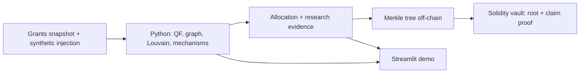

# QF Collusion Hybrid

**Nghiên cứu cơ chế Quadratic Funding trước hành vi chia ví và thông đồng, kèm demo tương tác và nguyên mẫu chi trả Merkle trên EVM.**

Tác giả: **Nguyễn Đình Tú** · [Báo cáo học thuật](REPORT.md) · [Bằng chứng và giới hạn](docs/CLAIMS_EVIDENCE_LIMITS.md) · [Thông số gas](results/gas/phase3_gas_benchmark.md)

## Dự án giải quyết gì?

Standard QF thưởng cho nhiều khoản đóng góp độc lập, nhưng một người có thể chia đóng góp qua nhiều ví để tác động quỹ đối ứng. Dự án dựng đồ thị đồng đóng góp, phân cụm bằng Louvain, rồi so sánh chín cơ chế phân bổ trên các kịch bản tiêm tấn công có nhãn và cộng đồng ủng hộ organic. Phần EVM kiểm tra một luồng chi trả bằng Merkle proof và đo gas từ transaction receipt thật trên Hardhat cục bộ.

Kết quả nghiên cứu **có giới hạn**: `soft_base` cho đánh đổi thuận lợi trên synthetic held-out đã đo; thêm Shapley hoặc centrality không cải thiện đồng thời hai thước đo. Không có cơ chế thắng chung được khóa trước held-out: trên Dev, `soft_centrality` thấp hơn `soft_base` ở cả gain và damage. Merkle giảm gas công bố bảng chi trả nhưng tăng gas mỗi claim. Đây là nguyên mẫu học thuật; dữ liệu Gitcoin không có nhãn Sybil thật và vault chưa được audit hoặc triển khai công khai.

## Công nghệ sử dụng

| Thành phần | Công nghệ | Vai trò trong dự án |
|---|---|---|
| Phân tích và mô phỏng | Python 3.12, NumPy, SciPy, pandas, NetworkX | QF, đồ thị đồng đóng góp, Louvain, cơ chế đối chứng và thí nghiệm ghép cặp. |
| Giao diện | Streamlit, Plotly, matplotlib | Demo 5 tab, What-If, bảng đóng góp tùy chỉnh và hình báo cáo. |
| Hợp đồng và proof | Solidity 0.8.30, OpenZeppelin Contracts và Merkle Tree, ethers | Vault claim theo root, kiểm chứng proof và chống claim lặp. |
| Công cụ EVM | Hardhat 3, TypeScript | Biên dịch, kiểm thử hợp đồng và đo `receipt.gasUsed` trên chain cục bộ. |
| Kiểm thử và tái lập | pytest, npm test, lockfile và manifest SHA-256 | Khóa đầu vào, kiểm tra tính toán, bridge Python–EVM và số liệu báo cáo. |



## Bố cục repo

| Đường dẫn | Nội dung |
|---|---|
| [`src/qf_hybrid/`](src/qf_hybrid/) và [`scripts/`](scripts/) | Lõi khoa học, pipeline thí nghiệm và xuất manifest. |
| [`app.py`](app.py) | Demo Streamlit cục bộ. |
| [`evm/`](evm/) | Hợp đồng Solidity, bộ sinh Merkle, test bảo mật và benchmark. |
| [`configs/`](configs/) | Cấu hình Dev và cơ chế held-out đã khóa. |
| [`docs/`](docs/) và [`REPORT.md`](REPORT.md) | Định nghĩa toán học, data card, giao thức, trust model và báo cáo. |
| [`results/`](results/) | Bảng, hình, gas receipt và manifest làm bằng chứng. |
| [`tests/`](tests/) | Kiểm thử Python cho toán học, pipeline, giao diện và bridge EVM. |

`data/raw/`, `data/processed/`, `.venv/`, `evm/node_modules/` và thư mục build được Git bỏ qua. Dữ liệu Parquet gốc tải riêng bằng script có kiểm SHA-256; quyền tái phân phối dữ liệu chưa được xác minh.

## Tài liệu và kết quả

| Tài liệu | Vai trò |
|---|---|
| [MATH_SPEC v1.0](docs/MATH_SPEC.md) | Định nghĩa dữ liệu, đồ thị G1/G2, QF, Shapley cụm, cơ chế và leaf Merkle đã khóa. |
| [DATA_CARD](docs/DATA_CARD.md) | Nguồn Grants Data Portal, SHA-256, điều kiện lọc, thiếu nhãn Sybil và bản quyền dữ liệu chưa xác minh. |
| [EXPERIMENT_PROTOCOL](docs/EXPERIMENT_PROTOCOL.md) | Split Dev/held-out, generator, ngân sách, seed, chỉ số và kiểm định theo khối. |
| [TRUST_MODEL](docs/TRUST_MODEL.md) | Phân định bảng payout được Merkle xác thực và phép tính ngoài chuỗi mà owner phải chịu trách nhiệm. |
| [CLAIMS_EVIDENCE_LIMITS](docs/CLAIMS_EVIDENCE_LIMITS.md) | Sáu nhóm kết luận gắn với số liệu, CI/`p_holm`/gas và giới hạn suy rộng. |
| [Phase 2 handoff](docs/PHASE2_HANDOFF.md) · [Phase 3 handoff](docs/PHASE3_HANDOFF.md) · [Phase 5.2 handoff](docs/PHASE5_2_HANDOFF.md) | Log, hash bảo toàn và điều kiện tái lập từng giai đoạn. |

Bảng gốc ở [results/tables](results/tables/), receipt và tổng hợp gas ở [results/gas](results/gas/); bốn hình 300 DPI ở [results/figures](results/figures/). [Manifest nguồn](data/manifests/sources.json) khóa ba Parquet bằng SHA-256; dữ liệu raw không được đưa vào repo vì giấy phép tái sử dụng của tập dữ liệu riêng chưa xác minh. Mã các cơ chế ở [src/qf_hybrid](src/qf_hybrid/); hợp đồng và công cụ Merkle ở [evm](evm/).

## Giao diện thuyết trình cục bộ

Sau khi cài lõi theo phần xác minh bên dưới, cài dependency UI đã khóa và chạy từ thư mục gốc repo:

```powershell
.venv\Scripts\python.exe -m pip install -r requirements-ui.txt
.venv\Scripts\python.exe -m pip check
.venv\Scripts\streamlit.exe run app.py --server.address 127.0.0.1
```

Giao diện gồm 5 tab: trực giác QF, soi cụm, Red Team synthetic, proof Merkle và gas, bằng chứng học thuật. Ở Tab 03, mở **What-If** để chỉnh quỹ `B`, số ví organic, hệ số phạt, Louvain và ngưỡng Pairwise. Dòng **Tùy chỉnh của tôi** được tính lại cạnh các cơ chế Phase 2 giữ nguyên cấu hình đã khóa khi bấm nút chạy. Chọn **Bảng đóng góp của tôi** để thêm/sửa/xóa các dòng `(ví, dự án, USD)`, bấm **Tính phân bổ trực tiếp**, rồi **Sinh cây Merkle trực tiếp từ kết quả này**. Dòng trùng `(ví, dự án)` được cộng gộp; nút reset nạp lại 10 dòng mẫu. Chỉnh giả định hoặc bảng chỉ đánh dấu kết quả cũ, khóa tạo root và thu hồi bundle demo trước đó; mô phỏng không tự tính lại trên từng thao tác. Tab 04 tự chọn bundle vừa sinh, cho phép xem proof và thử sửa `+1 wei`.

Hai bundle ở `results/gas/demo_merkle_round_27.json` và `demo_merkle_round_867.json` dùng leaf chuẩn OpenZeppelin và vault demo trên chainId 31337. Bundle mới chỉ nằm trong phiên Streamlit; pool 1 ETH dùng để chia theo **tỷ lệ** phân bổ USD, không phải phép đổi tiền tệ. **Root chưa được xuất bản lên chain; địa chỉ vault demo chưa triển khai.** Bộ thử Red Team tính thế giới đối chứng mới từ dữ liệu synthetic, không thay thế kết quả Phase 2 đã khóa. Khởi chạy web không cần Hardhat và không chạy lại benchmark gas.

## Xác minh bản đã khóa

Trên Windows với Python 3.12 và Node 24, từ thư mục gốc repo:

```powershell
python -m venv .venv
.venv\Scripts\python.exe -m pip install -r requirements.lock
.venv\Scripts\python.exe -m pip install --no-deps -e .
.venv\Scripts\python.exe scripts\fetch_data.py
.venv\Scripts\python.exe -m pip check
.venv\Scripts\python.exe -m pytest -q
cd evm
npm ci
npm run compile
npx tsc --noEmit
npm test
cd ..
```

`pytest` và `npm test` cần các Parquet đã tải ở `data/raw/`; `fetch_data.py` kiểm SHA-256 theo [manifest](data/manifests/sources.json). Các lệnh xác minh này không chạy lại mô phỏng Phase 2. Kiểm thử Phase 4 chỉ đọc các bảng/hình đã khóa. `npm run benchmark` **không nằm trong bước kiểm tra Phase 4**; kết quả gas đã lưu cùng receipt gốc.

## Tái lập đầy đủ từ dữ liệu gốc (trong checkout riêng)

Sau khi cài dependency như trên, chạy đúng thứ tự để dựng lại các giai đoạn:

```powershell
.venv\Scripts\python.exe scripts\fetch_data.py
.venv\Scripts\python.exe scripts\profile_data.py
.venv\Scripts\python.exe scripts\smoke_core.py
.venv\Scripts\python.exe scripts\run_phase2_dev.py
.venv\Scripts\python.exe scripts\run_phase2_heldout.py
.venv\Scripts\python.exe scripts\recompute_phase2_stats.py
.venv\Scripts\python.exe scripts\audit_phase2_selection.py
.venv\Scripts\python.exe scripts\plot_phase2.py
cd evm
npm run compile
npm test
npm run benchmark
cd ..
.venv\Scripts\python.exe scripts\summarize_gas.py
.venv\Scripts\python.exe -m pytest -q
```

Dev phải chạy trước held-out để khóa `configs/heldout/frozen_mechanisms.json`. Nên tái lập từ đầu trong checkout riêng để tránh thay thế bảng và hình đã nghiệm thu. Phase 4 chỉ tổng hợp báo cáo và kiểm tra nhất quán, không sinh thêm dữ liệu khoa học. Benchmark báo cáo **gas units** trên Hardhat cục bộ, không quy đổi thành phí USD mainnet.

## Nguồn và giấy phép

Xem [THIRD_PARTY_NOTICES](THIRD_PARTY_NOTICES.md) và [DATA_CARD](docs/DATA_CARD.md). Code repo và dữ liệu Parquet tải riêng có trạng thái giấy phép khác nhau; không suy ra quyền tái phân phối dữ liệu từ giấy phép code portal.
