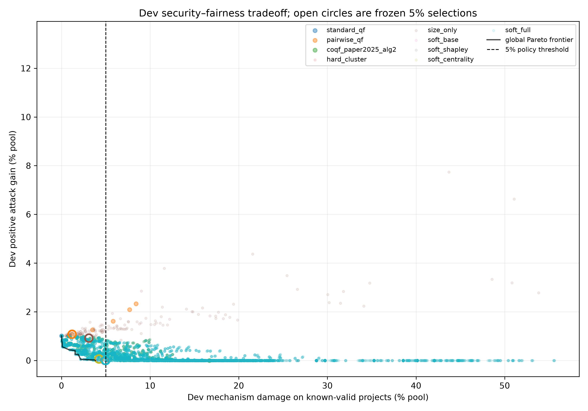
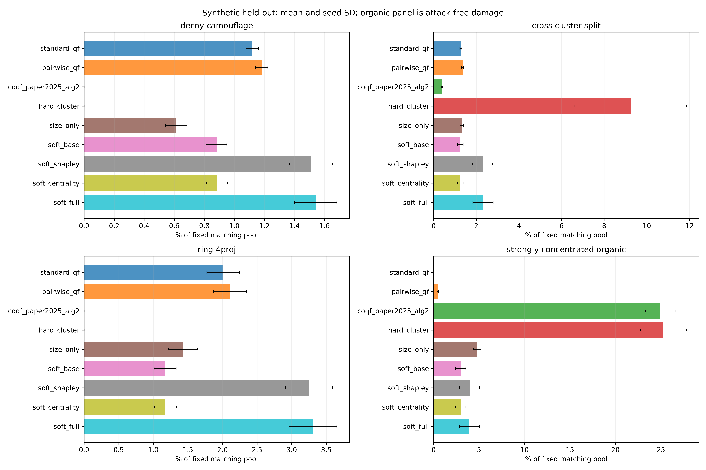
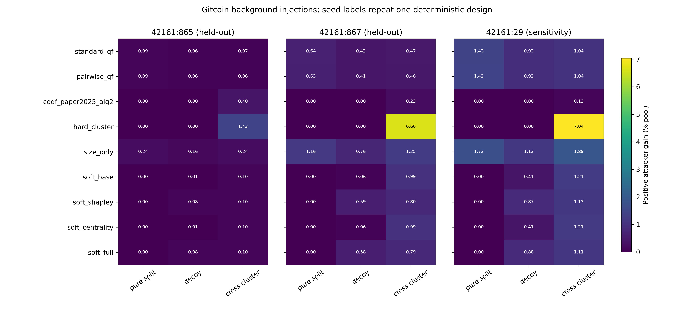
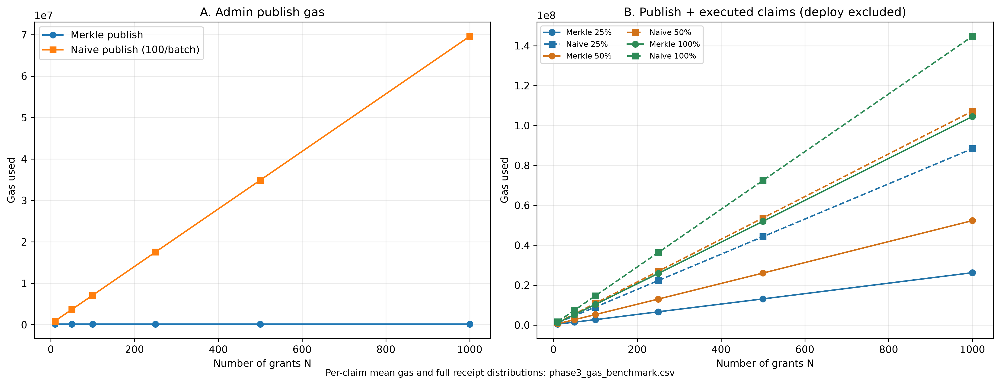

# Tài trợ bậc hai trước thông đồng: đánh đổi an toàn–công bằng và chi trả bằng Merkle Vault

**Báo cáo nghiên cứu cuối kỳ · 26/11/2026.** Đặc tả toán học và giao thức thực nghiệm được khóa trước khi mở tập held-out; báo cáo này tổng hợp các bảng và hình đã lưu, không chọn lại cấu hình hoặc chạy lại mô phỏng. Đơn vị `% B` là phần trăm quỹ đối ứng nghiên cứu, không phải tỷ suất lợi nhuận của kẻ tấn công.

## 1. Tóm tắt

Nghiên cứu đặt hai câu hỏi: có thể giảm lợi ích phân bổ cho các ví phối hợp mà vẫn bảo vệ cộng đồng ủng hộ thật hay không, và có thể công bố/chi trả bảng phân bổ với gas phù hợp quy mô hay không? Chúng tôi xây hai đồ thị đồng đóng góp có trọng số từ dữ liệu đóng góp, phân cụm Louvain, tính Shapley cụm giải tích, rồi so sánh chín cơ chế dưới cùng giao thức red-team. Trên synthetic held-out, `soft_base` đạt gain tấn công trung bình **1.101% B** và tổn hại cộng đồng organic **2.995% B** trong khi ngưỡng chính sách Dev là 5%. Kết quả âm tính cần giữ nguyên: `soft_shapley` và `soft_full` lần lượt có gain **2.352%** và **2.387% B**, kém `soft_base` với `p_holm=0.0078125`; centrality riêng chỉ đổi khoảng **+0.002532 điểm phần trăm B** theo hướng kém hơn. Các kết quả này thuộc mô phỏng có nhãn, không phải xác nhận nhận dạng Sybil ngoài đời ([bảng synthetic](results/tables/phase2_heldout_synthetic.csv), [kiểm định](results/tables/phase2_paired_ablation_stats.csv)).

Phần chi trả dùng manifest Python, cây Merkle chuẩn OpenZeppelin và vault Solidity. Hai vòng nền thực với **46/46** và **142/142** khoản chi được claim chính xác trên EVM cục bộ. Với N=10…1000, publish tiết kiệm **84.6%–99.8% gas** so với đối chứng lưu từng payout; tổng publish+claim tiết kiệm **27.8%–70.4%** tại các tỷ lệ claim đã đo, dù mỗi claim Merkle tốn thêm trung bình khoảng **24,335–29,283 gas**. Đây là gas trên Hardhat Cancun, không phải phí USD mainnet ([bảng gas](results/gas/phase3_gas_benchmark.csv), [hình 4](results/figures/fig04_gas_benchmark.png)).

## 2. Đặt vấn đề và phạm vi

Quadratic Funding (QF) tăng trọng số cho sự ủng hộ rộng rãi, nhưng một người tách đóng góp thành nhiều ví có thể làm tăng matching. Quan sát chuỗi `(donor, project, amount)` không chứa danh tính người thật. Hai thế giới gồm 50 người thật cùng ủng hộ vài dự án và một người điều khiển 50 ví tạo đúng cùng bảng quan sát là **không phân biệt được chỉ từ bảng ấy**. Vì vậy các đặc trưng đồ thị mô tả phối hợp, không tự thân là nhãn gian lận; mục tiêu thực nghiệm là đo đánh đổi trên thế giới synthetic có nhãn và mô tả tác động của tấn công tiêm trên nền Gitcoin không nhãn ([Data card](docs/DATA_CARD.md), [Trust model](docs/TRUST_MODEL.md)).

Mọi phép chiếu đồ thị, Louvain, centrality, Shapley, tuning và phân bổ chạy **ngoài chuỗi** trên dữ liệu đóng góp có nguồn gốc on-chain. Hợp đồng chỉ nhận bảng chi trả đã chốt. Hai câu hỏi nghiên cứu độc lập là (i) lợi ích matching biên cho tập mục tiêu tấn công so với thiệt hại của tập organic hợp lệ và (ii) gas admin/publisher so với gas người gọi claim trong hai kiến trúc payout.

## 3. Nghiên cứu liên quan và phạm vi kế thừa

Standard QF của **Buterin–Hitzig–Weyl** là mốc toán học cho raw matching giữa các người đóng góp. [Pairwise-bounded QF của Buterin (2019)](https://ethresear.ch/t/pairwise-coordination-subsidies-a-new-quadratic-funding-design/5553) giảm trọng số cặp ví có tổng phối hợp lớn; hệ số của dự án không thể được suy ra đơn giản từ giới hạn raw theo cặp sau khi chuẩn hóa vào cùng quỹ B. [`CO-QF` của Miller–Weyl–Kanich (2025), Algorithm 2](https://arxiv.org/html/2509.18343v1#S6) dùng các nhóm ủng hộ chồng lấn. Triển khai ở đây có tên chính xác `coqf_paper2025_alg2`; **không** thay thế, tái sử dụng, hay khẳng định so sánh với biến thể Gitcoin Markov/COCM do Joel Miller phát triển năm 2024. Mã GPL-3.0 của `qf-variants` không được sao chép; quá trình khảo sát trước đây có đọc repo đó nên cũng không tuyên bố clean-room tuyệt đối ([ghi chú bên thứ ba](THIRD_PARTY_NOTICES.md), [đặc tả](docs/MATH_SPEC.md)).

Ở tầng chi trả, thư viện `@openzeppelin/merkle-tree` sinh `StandardMerkleTree` và `MerkleProof.verifyCalldata` trong OpenZeppelin Contracts xác nhận leaf. `Ownable` và `ReentrancyGuard` bảo vệ quyền công bố và đường chuyển ETH. Sự kế thừa này chỉ dành cho primitive xác thực; logic xuất manifest, khóa domain, trạng thái từng vòng, đối chứng lưu trực tiếp và benchmark là phần triển khai của dự án ([handoff Phase 3](docs/PHASE3_HANDOFF.md), [hợp đồng Merkle](evm/contracts/MerkleQFVault.sol)).

## 4. Mô hình toán học và thuật toán (Giai đoạn 1)

Từ các sự kiện hợp lệ, tổng hợp Decimal **trước căn bậc hai**: $c_{up}=\sum_{e:u,p}\mathrm{USD}_e$. Với $P_u=\{p:c_{up}>0\}$, số người ủng hộ dự án $d_p$ và độ hiếm $\rho_p=1/\ln(2+d_p)$, hai phép chiếu donor–project thành donor–donor là

\[
w^{G1}_{uv}=\frac{\sum_{p\in P_u\cap P_v}\rho_p}{|P_u\cup P_v|},\qquad
w^{G2}_{uv}=\sum_{p\in P_u\cap P_v}\rho_p.
\]

G1 là overlap hiếm tự thiết kế, không gọi nhầm là weighted Jaccard chuẩn; G2 là tổng đồng dự án có chiết khấu theo độ phổ biến, không đồng nhất với Adamic–Adar gốc. Nếu hai ví chỉ cùng đóng một dự án, cả hai vẫn trả $\rho_p$, tránh việc cosine chuẩn hóa triệt tiêu tín hiệu hiếm. Mỗi donor giữ top-k láng giềng có trọng số dương, rồi lấy hợp để tạo đồ thị vô hướng; Louvain có seed và resolution cố định theo cấu hình. Dựng ứng viên thưa tránh ma trận $N\times N$, nhưng tình huống xấu vẫn phụ thuộc $\sum_p d_p(d_p-1)/2$, không được gọi cả pipeline là $O(KP)$ ([đặc tả](docs/MATH_SPEC.md), [hồ sơ bốn vòng](results/tables/phase1_data_graph_profile.csv)). Ở vòng `27`, G1 có 2,728,621 cặp ứng viên nhưng chỉ giữ 32,416 cạnh sau top-10; benchmark Pairwise thưa cho vòng này mất 0.926 giây tính cache và năm giá trị τ, chưa gồm đọc Parquet ([benchmark](results/tables/phase2_pairwise_sparse_benchmark.csv)).

Với phân hoạch cụm **cố định** $C_1,\ldots,C_K$, đặt $a_{kp}=\sum_{u\in C_k}\sqrt{c_{up}}$, $b_{kp}=\sum_{u\in C_k}c_{up}$, $A_p=\sum_k a_{kp}$. Standard QF có raw matching $R_p^{Std}=A_p^2-\sum_k b_{kp}$. Phân rã đóng góp Shapley chính xác của cụm là

\[
I_{kp}=a_{kp}^{2}-b_{kp},\qquad
E_{kp}=a_{kp}(A_p-a_{kp}),\qquad
\phi_{kp}=I_{kp}+E_{kp},\qquad
S_k=\frac{\sum_p I_{kp}}{\sum_p\phi_{kp}}.
\]

Nếu mẫu số của $S_k$ bằng 0, đặt $S_k=0$ và gắn cờ. Vì biểu thức bậc hai có các hạng giao cặp, mỗi hạng liên cụm chia đều trong Shapley; tính $\phi$ sau tổng hợp cần $O(KP)$, thay cho vét cạn $2^K$. [Kiểm thử](tests/unit/test_math.py) đối chiếu hoán vị và công thức liên minh tại $K=2,3,5,8$. $I_{kp}$ là matching nội cụm, **không** phải thiệt hại gian lận.

Hai tín hiệu bổ sung là $R_k=\mathrm{cohesion}_k=2W_{int}/(2W_{int}+W_{ext})$ và $C_k^{strength}=(n\sum_{u\in C_k}(s_u/\sum_v s_v)^2-1)/(n-1)$, với $s_u$ là tổng trọng số cạnh nội cụm chạm $u$. Độ tập trung dự án là $1-H(P(C_k))/\ln|P_{round}|$. Singleton và mẫu số 0 được quy ước bằng 0, có cờ giải thích. Không tín hiệu nào chứng minh một ví là Sybil ([đặc tả](docs/MATH_SPEC.md)).

Chiết khấu mềm đặt $\lambda_k=\mathrm{clip}(\beta_0+\beta_{coh}R_k+\beta_{conc}\mathrm{projConc}_k+\beta_S S_k+\beta_C C_k^{strength},0,1)$ cho cụm nhiều ví; singleton có $\lambda_k=0$. Khi đó

\[
a^{eff}_{kp}=(1-\lambda_k)a_{kp}+\lambda_k\sqrt{b_{kp}},\qquad
R_p^{soft}=\left(\sum_k a^{eff}_{kp}\right)^2-\sum_k b_{kp},\qquad
m_p=\begin{cases}B R_p/\sum_qR_q,&\sum_qR_q>0,\\0,&\text{ngược lại.}\end{cases}
\]

Chỉ khi $\lambda_k=1$, tổng đóng góp từng dự án không đổi và các ví tách **vẫn ở cùng phân hoạch**, $a^{eff}_{kp}=\sqrt{b_{kp}}$ mới bất biến theo cách chia ví. Tại $\lambda_k<1$, [phản ví dụ đã kiểm thử](tests/unit/test_math.py) cho score tăng; tấn công còn có thể đổi đồ thị và phân hoạch. Khi mọi raw score bằng 0, toàn quỹ giữ ở `unallocated`, không cấp phát tùy ý.

Chín cơ chế gồm `standard_qf`, `pairwise_qf` với $k_{uv}=\tau/(\tau+\sum_p\sqrt{c_{up}c_{vp}})$, `coqf_paper2025_alg2` với nhóm ủng hộ chồng lấn và trọng số $w_{ig}=c_{ig}/\sum_h c_{ih}$, `hard_cluster`, `size_only`, `soft_base`, `soft_shapley`, `soft_centrality`, `soft_full`. Bốn nhánh soft chỉ khác tập hệ số bật; mỗi nhánh được chọn trên Dev cùng tiêu chí. Với các nhóm ủng hộ chồng lấn $g,h$, CO-QF paper 2025 cộng theo cặp **có thứ tự** $g\ne h$:

\[
R_p^{CO}=\sum_{g\ne h}\sqrt{\left(\sum_{i\in g\setminus h}c_{ip}w_{ig}\right)\left(\sum_{j\in h\setminus g}c_{jp}w_{jh}\right)}.
\]

Đây là Algorithm 2 trong [MATH_SPEC](docs/MATH_SPEC.md); lưới siêu tham số và quy tắc từng nhánh cũng ở đó.

## 5. Dữ liệu và giao thức red-team (Giai đoạn 2)

Snapshot Grants Data Portal gồm donations, rounds và applications, khóa SHA-256 trong [manifest nguồn](data/manifests/sources.json). Tệp donations có 497,347 sự kiện; bốn vòng Arbitrum đã kiểm toán được tóm tắt dưới đây. `rows_kept` đòi USD hữu hạn, dương, ứng dụng hiện `APPROVED` khớp dự án và timestamp nằm trong cửa sổ ghi nhận ([CSV hồ sơ](results/tables/phase1_data_graph_profile.csv), [Data card](docs/DATA_CARD.md)).

| Vòng `42161:` | Tổng hàng | Hàng giữ | Donor sau lọc | Dự án |
|---:|---:|---:|---:|---:|
| 27 | 13,197 | 13,187 | 3,750 | 46 |
| 29 | 9,314 | 9,276 | 2,261 | 129 |
| 865 | 12,883 | 12,865 | 4,411 | 56 |
| 867 | 11,059 | 11,052 | 3,861 | 142 |

`42161:27` là empirical Dev; `865` và `867` là held-out khác mùa; `29` chỉ xem độ nhạy cùng mùa. Synthetic Dev và held-out dùng **họ generator khác nhau**; held-out có organic tập trung mạnh và ba họ attack `decoy_camouflage`, `cross_cluster_split`, `ring_4proj`. Mọi cặp thế giới dùng cùng nền, cùng ngân sách kẻ tấn công và cùng tổng đóng góp theo dự án mục tiêu $A$; ring so với `D_uncoordinated` gồm một donor riêng cho từng team, còn split so với `D_single`. Sau khi tiêm, đồ thị, Louvain, đặc trưng và phân bổ đều tính lại; không giữ cố định cụm từ thế giới trước attack ([giao thức khóa](docs/EXPERIMENT_PROTOCOL.md)).

Thước đo lợi ích mục tiêu là $\Delta_A=\sum_{p\in A}m_p^{split}-\sum_{p\in A}m_p^{comparator}$; báo cáo cả dấu và phần dương. Đây là chênh lệch matching, **không** trừ chi phí thực thi hoặc quy thành lợi nhuận. Với tập $H$ hợp lệ biết trước trong synthetic, $\mathrm{MechDamage}(H)=\sum_{p\in H}\max(0,m_p^{Std}-m_p^{method})/\sum_{p\in H}m_p^{Std}$. Chọn cấu hình trên Dev theo damage $\leq5\%$ B rồi tối thiểu hóa gain, có thứ tự tie-break khóa sẵn; nhánh 2% và 10% chỉ là độ nhạy trên Dev. [Tệp frozen](configs/heldout/frozen_mechanisms.json) được ghi trước khi đọc held-out. B=USD 10,000 trong synthetic và USD 100,000 trong empirical là **quỹ nghiên cứu phản thực**, không phải quỹ lịch sử.

Kiểm định synthetic dùng 10 khối seed dùng chung ba họ attack (30 cặp trial), bootstrap ghép cặp 10,000 lần, sign-flip hai phía, Holm theo từng gia đình so sánh. Năm nhãn seed cho mỗi family/round empirical tạo **cùng một thiết kế tiêm tất định**, không phải năm lần lặp độc lập. Vì chỉ có hai vòng empirical held-out, nghiên cứu không gán CI/p-value cho các con số Gitcoin ([giao thức](docs/EXPERIMENT_PROTOCOL.md), [bảng kiểm định](results/tables/phase2_paired_ablation_stats.csv)).

## 6. Kết quả, ablation và diễn giải

Trên Dev tại ngưỡng 5%, `soft_base` chọn G2, k=40, resolution=0.5, $\beta_0=-0.5$, $\beta_{coh}=0.8$, $\beta_{conc}=0.8$; damage **4.267% B**, gain **0.0616% B**. Hai nhánh có Shapley chọn gần-zero gain trên Dev, nhưng kết quả đó không chuyển sang held-out. [Bảng lựa chọn Dev](results/tables/phase2_dev_selection.csv) và đường đánh đổi [Hình 1](results/figures/fig01_tradeoff_frontier_dev.png) thể hiện quy trình trước khi khóa.

Trong bảng dưới, gain là trung bình phần dương của $\Delta_A/B$ trên ba họ synthetic held-out; damage là trung bình `MechDamage(H)` của cộng đồng organic tập trung mạnh, đều tính bằng `% B` ([dữ liệu trial](results/tables/phase2_heldout_synthetic.csv)).

| Cơ chế | Gain attack (% B) ↓ | Damage organic (% B) ↓ |
|---|---:|---:|
| `standard_qf` | 1.469 | 0.000 |
| `pairwise_qf` | 1.552 | 0.446 |
| `coqf_paper2025_alg2` | **0.133** | **24.928** |
| `hard_cluster` | **3.079** | **25.265** |
| `size_only` | 1.121 | 4.799 |
| `soft_base` | **1.101** | **2.995** |
| `soft_shapley` | 2.352 | 3.961 |
| `soft_centrality` | 1.104 | 2.993 |
| `soft_full` | 2.387 | 3.942 |

`soft_base` là một điểm không bị trội theo hai thước đo trung bình trên synthetic held-out và là nhánh đơn giản để trình bày đánh đổi; đây là diễn giải sau held-out, không phải người thắng chung được khóa trước held-out. Trên Dev, `soft_centrality` có cả gain và damage thấp hơn `soft_base`, còn các nhánh có Shapley đạt gain gần 0 nhưng không chuyển được kết quả đó sang held-out. CO-QF chặn gain rất mạnh (**0.133% B**) nhưng tổn hại organic (**24.928% B**) gấp khoảng năm lần ngưỡng chính 5%. `HardCluster` vừa làm mất **25.265% B** ở nhóm hợp lệ vừa để gain **3.079% B**; tách cụm qua dự án mồi phá giả định cùng cụm cố định. Hình 2 hiển thị kết quả ablation.

So với `soft_base`, `soft_full` tăng gain **+1.286 điểm phần trăm B**, CI 95% **[+1.160,+1.389]**, `p_holm=0.0078125`; `soft_shapley` tăng **+1.251 điểm**, CI **[+1.126,+1.353]**, cùng `p_holm`. `soft_centrality` tăng chỉ **+0.002532 điểm**, CI **[+0.002027,+0.003054]**, cùng `p_holm`: hướng ổn định trong generator nhưng cỡ hiệu ứng rất nhỏ. [Bảng kiểm định](results/tables/phase2_paired_ablation_stats.csv) dùng khối seed làm đơn vị. Cấu hình Shapley/full có Dev gain gần 0 nhưng held-out xấu đi, phù hợp với **quá khớp vào họ attack Dev**; đây là diễn giải thực nghiệm, không phải chứng minh tính chất nhân quả của Shapley. Kiểm toán sau held-out còn phát hiện việc so sánh float gần **10⁻¹⁹ B** làm tie-break chọn cấu hình damage Dev 4.926%/4.993% thay vì phương án 3.859%/3.830% nếu coi gần-zero bằng nhau. Phương án thay thế **không** được chạy held-out và không được dùng để sửa kết luận ([kiểm toán](results/tables/phase2_numerical_selection_audit.csv)).

Trên nền Gitcoin `865`+`867` có tấn công tiêm, gain trung bình ba họ của `soft_base` **0.195% B** so với Standard **0.291% B**; ở vòng sensitivity `29` là **0.540%** so với **1.133% B**. `soft_full` ở hai vòng chính là **0.258% B**, cũng không vượt `soft_base`. CO-QF đạt **0.105% B**, nhưng tổng chênh lệch tuyệt đối với Standard trên background là **115.56% B**. Chỉ số `DiffVsStandard` cộng cả hai phía của thay đổi phân bổ nên có thể vượt 100% B, tối đa 200% B; nó **không** phải `MechDamage(H)` hay ước lượng phạt oan người thật. Đó là mô tả của thiết kế tiêm trên nền không nhãn, không phải kiểm định độc lập trên người dùng thật ([bảng empirical](results/tables/phase2_heldout_empirical.csv), [Hình 3](results/figures/fig03_heldout_empirical_gitcoin.png)).

## 7. Kiến trúc Hybrid, kiểm thử bảo mật và gas (Giai đoạn 3)

Pipeline lấy tỷ lệ phân bổ `soft_base` đã khóa cho `42161:27` và `42161:867`, rồi chuẩn hóa **riêng** vào 100 ETH native test. Với quota $q_i$ đơn vị wei, đặt $f_i=\lfloor q_i\rfloor$, phát phần dư $B-\sum_i f_i$ theo fractional remainder giảm dần, `grant_id` tăng dần khi hòa; bất biến $\sum_i payout_i+unallocated=B$. USD nghiên cứu **không** được đổi nhãn thành wei. [Exporter](scripts/export_phase3_manifests.py) ghi manifest, [builder](evm/scripts/build_merkle.ts) dùng `BigInt`, xác thực schema và xuất root/proof cùng SHA-256 provenance. Cả tám cặp manifest/bundle khớp canonical hash giữa Python và Node ([handoff](docs/PHASE3_HANDOFF.md)).

Leaf có tám trường theo thứ tự `(schemaVersion, chainId, vault, assetAddress, roundId, grantId, recipient, amount)`, ABI là `(uint256,uint256,address,address,uint256,uint256,address,uint256)` và được double-hash theo `StandardMerkleTree`. Contract tái tạo leaf từ `block.chainid`, `address(this)` và native asset zero address, rồi gọi `MerkleProof.verifyCalldata`. `MerkleQFVault` lưu root, deadline, funded/remaining cho từng round và `claimed[roundId][grantId]`; chuyển ETH sau cập nhật trạng thái (CEI), có `ReentrancyGuard`. `NaiveStorageQFVault` là đối chứng lưu payout trên chuỗi theo lô 100, `finalize` trước claim ([hai hợp đồng](evm/contracts/MerkleQFVault.sol), [đối chứng](evm/contracts/NaiveStorageQFVault.sol)).

[Kiểm thử bảo mật](evm/test/security.ts) chạy đầu-cuối **46/46** và **142/142** claim từng wei, cùng thay đổi amount/recipient/grant/round/proof byte, domain vault/chain sai, replay, công bố trùng, non-owner, deadline, sweep tách vòng, reentrancy và recipient từ chối ETH. Cả Python exporter, TypeScript validator và EVM claim đều từ chối payout recipient bằng địa chỉ 0, kể cả khi root cố ý chứa leaf đó; đối chứng naive khớp payout và các ca biên. Python có [kiểm thử bridge](tests/integration/test_phase3_bridge.py). Các kiểm thử là bằng chứng thực thi cục bộ, không thay thế audit độc lập.

Gas được đo từ **`receipt.gasUsed`** của mọi claim tại N=10, 50, 100, 250, 500, 1000; không dùng `estimateGas` hay ngoại suy. Compiler `solc 0.8.30`, optimizer 200, Cancun, chain 31337. Deploy được tách khỏi lifecycle; publish naive là init + 1/1/1/3/5/10 batch + finalize. Bảng rút gọn dưới đây lấy từ [CSV gas](results/gas/phase3_gas_benchmark.csv); số chi tiết min/median/max, ba tỷ lệ lifecycle và receipt gốc ở [bảng gas](results/gas/phase3_gas_benchmark.md), [JSON receipt](results/gas/phase3_gas_receipts.json), [metadata](results/gas/phase3_evm_meta.json).

| N | Publish Merkle / naive (gas) | Tiết kiệm publish | Mean claim Merkle / naive (gas) | Tiết kiệm lifecycle 25% / 50% / 100% |
|---:|---:|---:|---:|---:|
| 10 | 137,465 / 892,622 | 84.6% | 98,922 / 74,587 | 61.1% / 50.0% / 31.2% |
| 50 | 137,453 / 3,655,578 | 96.2% | 101,050 / 74,971 | 68.6% / 51.8% / 29.9% |
| 100 | 137,465 / 7,109,328 | 98.1% | 101,847 / 75,019 | 70.1% / 51.8% / 29.4% |
| 250 | 137,465 / 17,543,622 | 99.2% | 102,834 / 75,048 | 70.3% / 51.7% / 28.8% |
| 500 | 137,465 / 34,888,152 | 99.6% | 103,593 / 75,063 | 70.4% / 51.5% / 28.3% |
| 1000 | 137,465 / 69,611,868 | 99.8% | 104,354 / 75,071 | 70.3% / 51.2% / 27.8% |

Root cần $O(1)$ storage **mỗi vòng**, dựng cây ngoài chuỗi $O(N)$, proof kiểm tra $O(\log N)$, nhưng mapping `claimed` vẫn tăng tới $O(N)$ theo số claim thành công. Admin trả gas deploy/publish; người **gọi** claim permissionless trả gas claim, còn ETH luôn chuyển tới recipient đã cam kết. `Merkle break-even claims = 0` trong bảng vì ngay sau publish Merkle đã rẻ hơn naive; không ngụ ý claim Merkle rẻ hơn. Chênh publish Merkle **12 gas** giữa N=50 và các N còn lại phù hợp với việc một byte calldata zero thay byte nonzero (4 so với 16 gas/byte), không phải đổi bậc độ phức tạp. Lifecycle đo các mốc 25/50/100% theo receipt claim thực; ở N=500 mốc 25% tiết kiệm **70.4%** khi làm tròn một chữ số ([Hình 4](results/figures/fig04_gas_benchmark.png)).

Giới hạn quản trị của payout: owner chọn hạn claim và được sweep phần dư sau hạn; contract chỉ kiểm tra `remaining` khi claim, không kiểm tra tổng payout trong root tại publish. Các quyền này phải được quản trị ngoài chuỗi nếu dùng ngoài nguyên mẫu.

## 8. Mô hình tin cậy, giới hạn và kết luận

Owner chọn hạn claim và được sweep quỹ chưa claim sau hạn. Contract không cưỡng chế `sum(leaves) <= poolFunded` tại lúc công bố root; nó chỉ kiểm tra số dư còn lại ở từng claim. Đây là giả định quản trị của nguyên mẫu cục bộ, không phải bảo đảm từ Merkle proof.

[Ma trận claim–evidence–limitation](docs/CLAIMS_EVIDENCE_LIMITS.md) là danh mục phát biểu có thể kiểm toán; [Trust model](docs/TRUST_MODEL.md) phân định điều hợp đồng chứng minh và điều nó phải tin ở publisher. Merkle proof chỉ chứng minh khoản chi nằm trong root do owner công bố, không chứng minh dữ liệu đầu vào, lựa chọn `soft_base`, thuật toán ngoài chuỗi, mapping recipient hay root công bố là đúng. SHA-256 provenance có trong bundle để kiểm toán ngoài chuỗi, Solidity không xác thực các digest ấy. Recipients Phase 3 là địa chỉ test tất định, không khẳng định người nhận thật có khóa. `npm audit` còn 12 cảnh báo trong dependency phát triển (8 low, 4 high qua Hardhat/`zod`), `--omit=dev` là 0; chưa có triển khai công khai hay audit contract độc lập.

Giới hạn khoa học lớn nhất là thiếu nhãn Sybil trên Gitcoin và khả năng phân hoạch đổi dưới tấn công. `soft_base` có đánh đổi thuận lợi trong **bộ dữ liệu, generator, lưới và ngưỡng chính sách đã khóa**, nhưng không có quy tắc chọn người thắng chung cho chín cơ chế được khóa trước held-out; không thể khẳng định phát hiện đồng lõa ngoài đời hoặc dùng ngay để phân tiền thật. Kết quả âm tính của Shapley/centrality trên held-out cho thấy thêm đặc trưng phức tạp không bảo đảm cải thiện, trong khi Merkle cho lợi ích gas publish rõ rệt nhưng chuyển một phần chi phí sang caller claim. Hướng nghiên cứu tiếp theo là bổ sung tín hiệu danh tính độc lập (Proof-of-Personhood hoặc Gitcoin Passport) có kiểm soát quyền riêng tư, đối chứng thực nghiệm với **bản Gitcoin Markov 2024** thay vì đồng nhất với paper 2025, và nghiên cứu bằng chứng ZK cho tính đúng của phép tính ngoài chuỗi. Các hướng này chưa được đánh giá trong báo cáo hiện tại.
